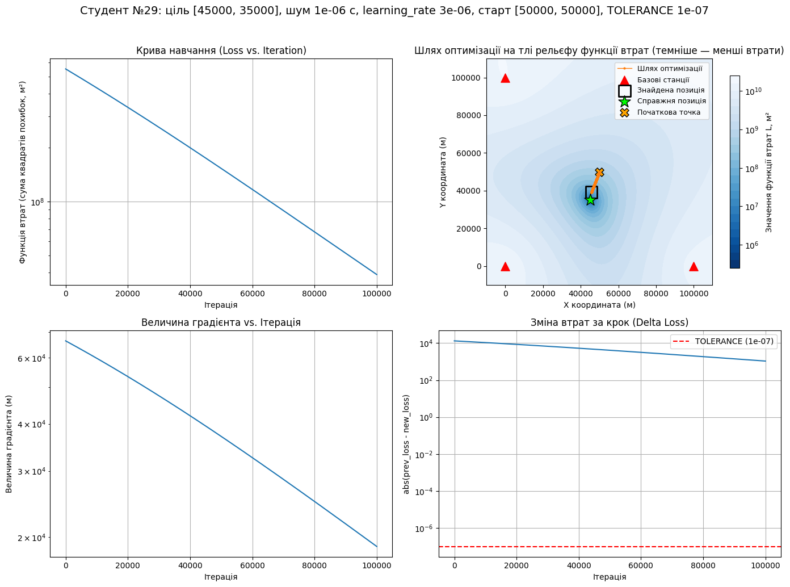
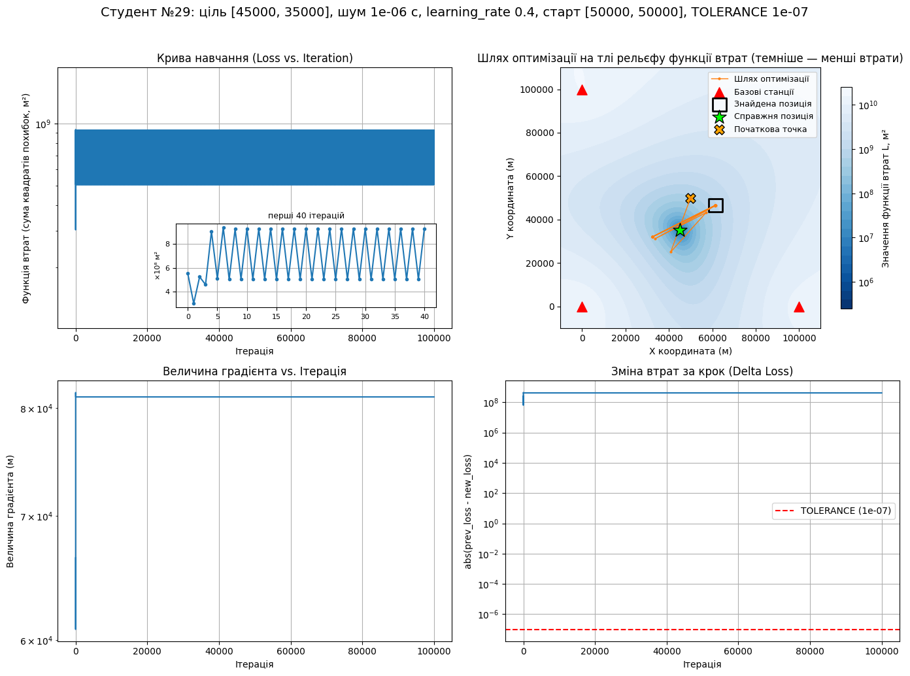
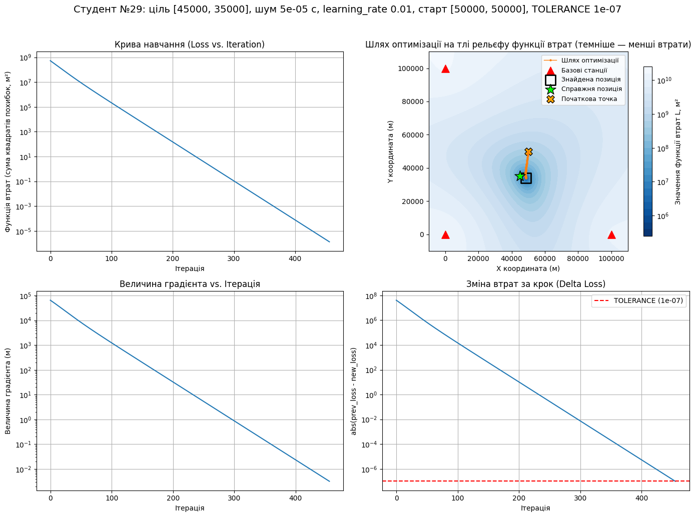
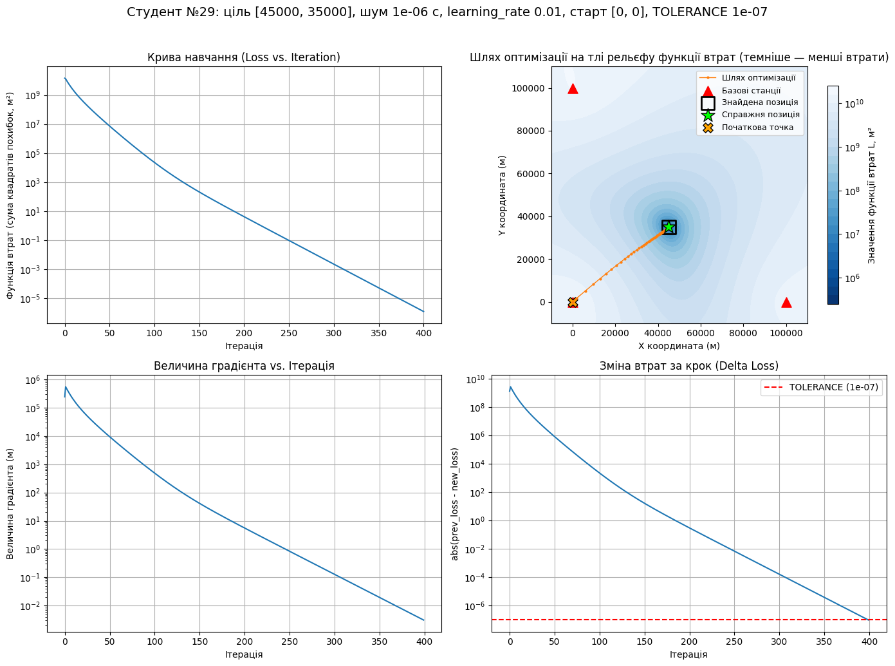
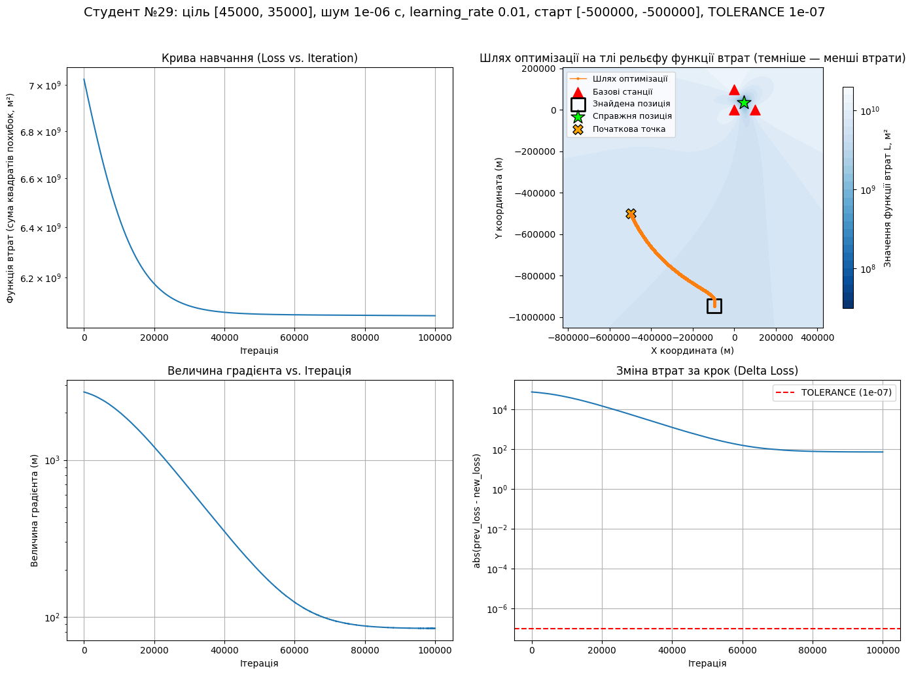
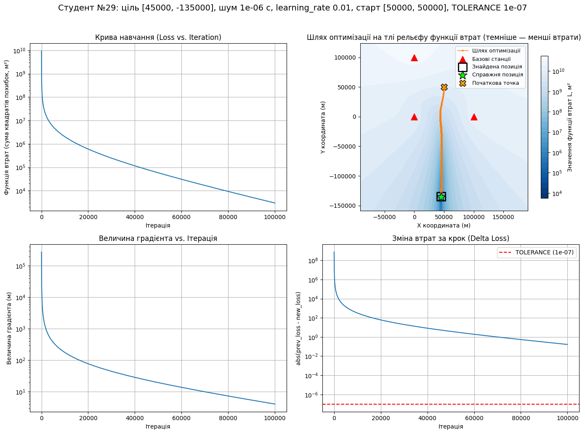
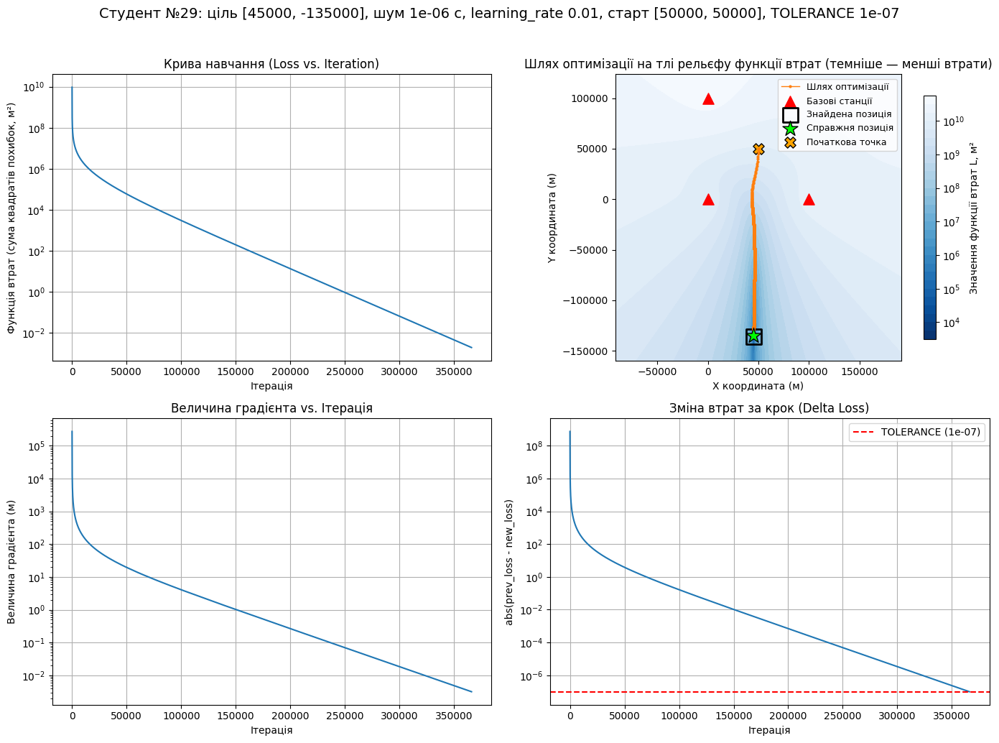
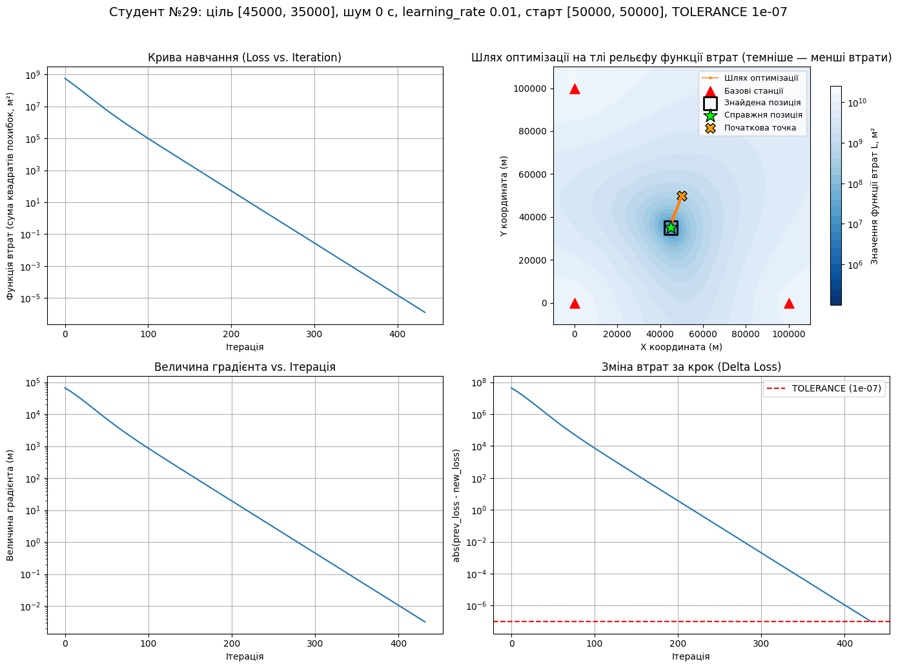

# Дослідження методу градієнтного спуску для розв’язання задачі мультилатерації (TDoA)

## Експеримент 1. Контрольний запуск

```python
run()
```

Вивід:

```
Студент №29
Справжня позиція: (45000.00, 35000.00) м
Знайдена позиція: (45000.00, 35000.00) м
Похибка позиціонування: 0.000830 м (0.83 мм)
Ітерацій: 433 (зупинка: зміна втрат за крок < TOLERANCE = 1e-07)
Фінальне значення функції втрат: 1.27e-06 м²
```


**Висновки:**

Шлях - майже пряма від старту до цілі по схилу єдиної «улоговини» рельєфу; справжня позиція точно в знайденій. Крива навчання, величина градієнта і зміна втрат за крок спадають однаково рівно (прямі на логарифмічній шкалі). Алгоритм зупиняється рівно тоді, коли зміна втрат за крок перетинає лінію TOLERANCE; похибка в цей момент ~ 0,83 мм.

## Експеримент 2. Швидкість навчання

```python
run(noise_level=1e-6, learning_rate=3e-6)   # 2a
run(noise_level=1e-6, learning_rate=0.01)   # 2b
run(noise_level=1e-6, learning_rate=0.2)    # 2c
run(noise_level=1e-6, learning_rate=0.4)    # 2d
```

| Запуск | learning_rate | Ітерацій | Причина зупинки | Похибка, м | Фінальне значення втрат, м² |
| --- | --- | --- | --- | --- | --- |
| 2a | 3e-6 | 100 000 | вичерпано MAX_ITERATIONS | 4 183.33 | 3.9e+07 |
| 2b | 0.01 | 434 | TOLERANCE | 76.08 | 1.22e-06 |
| 2c | 0.2 | 14 | TOLERANCE | 76.08 | 5.42e-09 |
| 2d | 0.4 | 100 000 | вичерпано MAX_ITERATIONS | 20 095.70 | 9.25e+08 |

- 2a



Точка рухається в правильному напрямку, але за 100 000 ітерацій не встигає дійти до цілі і зупиняється за ~4,18 км від неї. Втрати впали лише на один порядок (до 3.9e+07 м²) порівняно зі стартом.

- 2b


- 2c


Отримано ту саму відповідь, що й у 2b (похибка 76.08 м), але за 14 ітерацій замість 434 - у 31 раз швидше. На графіку шлях виглядає як кілька довгих кроків.

- 2d



Завеликий крок призводить до осциляції: на графіку шляху точка перестрибує через мінімум. На кривій навчання втрати чергуються між двома великими значеннями і не зменшуються; градієнт і зміна втрат - горизонтальні лінії високо над TOLERANCE. Похибка становить понад 20 км.

## Експеримент 3. Рівень шуму

```python
run(noise_level=1e-9)   # 3a
run(noise_level=1e-6)   # 3b (= 2b)
run(noise_level=5e-5)   # 3c
```

| Запуск | NOISE_LEVEL, с | Шум, м | Ітерацій | Похибка, м | Фінальне значення втрат, м² |
| --- | --- | --- | --- | --- | --- |
| 3a | 1e-9 | 0.30 | 433 | 0.075523 | 1.27e-06 |
| 3b | 1e-6 | 300 | 434 | 76.08 | 1.22e-06 |
| 3c | 5e-5 | 15 000 | 456 | 3 770.97 | 1.32e-06 |

- 3a


- 3b


- 3c



**Висновки:**

Усі три запуски успішно зупиняються за умовою TOLERANCE за 433-456 ітерацій з однаково майже нульовими втратами. Однак похибка лінійно зростає разом із шумом у ту саму кількість разів. Збільшення шуму в 1000 разів (від 1e-9 до 1e-6) збільшує похибку з ~7.5 см до 76.08 м (приблизно в 1000 разів). Подальше збільшення шуму в 50 разів (до 5e-5) призводить до збільшення похибки до ~3.77 км (приблизно в 50 разів).

## Експеримент 4. Початкове наближення

```python
run(noise_level=1e-6, initial_guess=[50000, 50000])       # 4a (= 2b)
run(noise_level=1e-6, initial_guess=[0, 0])               # 4b
run(noise_level=1e-6, initial_guess=[-500000, -500000])   # 4c
```

| Запуск | Старт, м | Ітерацій | Причина зупинки | Похибка, м | Фінальне значення втрат, м² |
| --- | --- | --- | --- | --- | --- |
| 4a | (50 000, 50 000) | 434 | TOLERANCE | 76.08 | 1.22e-06 |
| 4b | (0, 0) | 400 | TOLERANCE | 76.08 | 1.21e-06 |
| 4c | (−500 000, −500 000) | 100 000 | вичерпано MAX_ITERATIONS | 991 301.52 | 6.05e+09 |

- 4a


- 4b



- 4c



**Висновки:**

Старт 4b знаходиться втричі далі від цілі, ніж 4a, але алгоритм дістається туди навіть швидше (за 400 ітерацій замість 434), приходячи в ту саму точку з ідентичною похибкою 76.08 м. У випадку 4c старт знаходиться занадто далеко, на майже пласкій ділянці функції втрат. Тому шлях іде геть від станцій і за 100 000 ітерацій закінчується майже за 991 км від цілі з величезними втратами (6.05e+09 м²).

## Експеримент 5. Геометрія станцій (GDOP)

```python
run(noise_level=1e-6, true_position=[45000, 35000])     # 5a (= 2b)
run(noise_level=1e-6, true_position=[45000, -135000])   # 5b
run(noise_level=1e-6, true_position=[45000, -135000], max_iterations=1000000)   # 5c
```

| Запуск | Ціль, м | Ітерацій | Причина зупинки | Похибка, м | Фінальне значення втрат, м² |
| --- | --- | --- | --- | --- | --- |
| 5a | (45 000, 35 000) | 434 | TOLERANCE | 76.08 | 1.22e-06 |
| 5b | (45 000, −135 000) | 100 000 | вичерпано MAX_ITERATIONS | 522.39 | 2.97e+03 |
| 5c | (45 000, −135 000) | 366 075 | TOLERANCE | 989.19 | 1.88e-03 |

- 5a


- 5b



- 5c



**Висновки:**

Для цілі, що знаходиться далеко збоку від станцій (5b), рельєф утворює довгий вузький "каньйон". Шлях швидко скочується на його дно, а далі продовжується вздовж нього настільки повільно, що за 100 000 ітерацій умова зупинки не досягається, а похибка складає ~522 м. Якщо дозволити більше ітерацій (5c), алгоритм досягає TOLERANCE на 366 075-й ітерації. Похибка при цьому становить ~989 м, що в 13 разів більше, ніж для цілі між станціями (5a, 76.08 м) при однаковому рівні шуму. У цьому конкретному випадку 5b виявився ближчим до цілі (менша похибка), ніж 5c.

## Експеримент 6. Умова зупинки

```python
run(tolerance=1e-2)                      # 6a
run(tolerance=1e-7)                      # 6b (= контрольний запуск)
run(tolerance=1e-12)                     # 6c
run(noise_level=1e-6, tolerance=1e-2)    # 6d
run(noise_level=1e-6, tolerance=1e-12)   # 6e
```

| Запуск | TOLERANCE | Шум, с | Ітерацій | Похибка, м | Фінальне значення втрат, м² |
| --- | --- | --- | --- | --- | --- |
| 6a | 1e-2 | 0 | 280 | 0.260860 | 0.125 |
| 6b | 1e-7 | 0 | 433 | 0.000830 | 1.27e-06 |
| 6c | 1e-12 | 0 | 587 | 0.000003 | 1.2e-11 |
| 6d | 1e-2 | 1e-6 | 281 | 75.90 | 0.12 |
| 6e | 1e-12 | 1e-6 | 587 | 76.08 | 1.25e-11 |

- 6a


- 6b



- 6c


- 6d


- 6e


**Висновки:**

Без шуму кожне посилення умови зупинки TOLERANCE у 100 000 разів зменшує похибку на кілька порядків (~26 см → 0.83 мм → 3 мкм), потребуючи при цьому лише близько 150 додаткових ітерацій. Однак при наявності шуму (1 мкс) ці самі додаткові ітерації майже не впливають на результат. Похибка між 6d та 6e змінюється лише з 75.90 м до 76.08 м, оскільки в даному випадку шум домінує над точністю зупинки алгоритму.

## Загальний висновок

У ході виконання роботи було досліджено застосування методу градієнтного спуску для розв'язання задачі мультилатерації (TDoA). Результати експериментів демонструють, що хоча алгоритм є ефективним, його працездатність, точність та швидкість збіжності критично залежать від параметрів та зовнішніх умов:

1. Швидкість навчання (learning_rate): Є ключовим параметром для стабільної роботи алгоритму. Замалий крок призводить до стагнації (алгоритм не встигає дійти до мінімуму за відведений час), а завеликий - до осциляції, коли точка перестрибує ціль і втрати зростають.

2. Початкове наближення: Старт повинен знаходитися відносно недалеко від базових станцій. Якщо початкова точка лежить далеко за межами системи, алгоритм потрапляє на майже пласку ділянку рельєфу функції втрат (де градієнт прямує до нуля) і рухається у хибному напрямку.

3. Вплив шуму та умова зупинки: Рівень шуму у вимірюваннях фундаментально обмежує точність позиціонування - похибка зростає прямо пропорційно до збільшення шуму. За наявності реального фізичного шуму посилення математичної умови зупинки (TOLERANCE) стає неефективним, оскільки алгоритм все одно збігається до зміщеного.

4. Геометрія станцій (GDOP): Взаємне розташування цілі та базових станцій суттєво впливає на топологію функції втрат. Якщо ціль знаходиться далеко збоку від масиву станцій, утворюється довгий пологий "каньйон", що в десятки разів збільшує необхідну кількість ітерацій для збіжності та значно погіршує кінцеву точність позиціонування навіть при сталому рівні шуму.

Отже, для успішного застосування градієнтного спуску в системах TDoA необхідні ретельний підбір швидкості навчання, коректне задання початкової точки та врахування геометричного фактора погіршення точності (GDOP).